<div align="center">

# SystemLab

**Laboratoire interactif d'apprentissage et de simulation du System Design.**

Concevez. Simulez. Comprenez.

Construisez des architectures au glisser-déposer, simulez la charge, identifiez les goulots
d'étranglement, comparez vos solutions — et comprenez vraiment *pourquoi*.

[]()
[]()
[]()
[]()
[]()
[]()

</div>

<table>
  <tr>
    <td>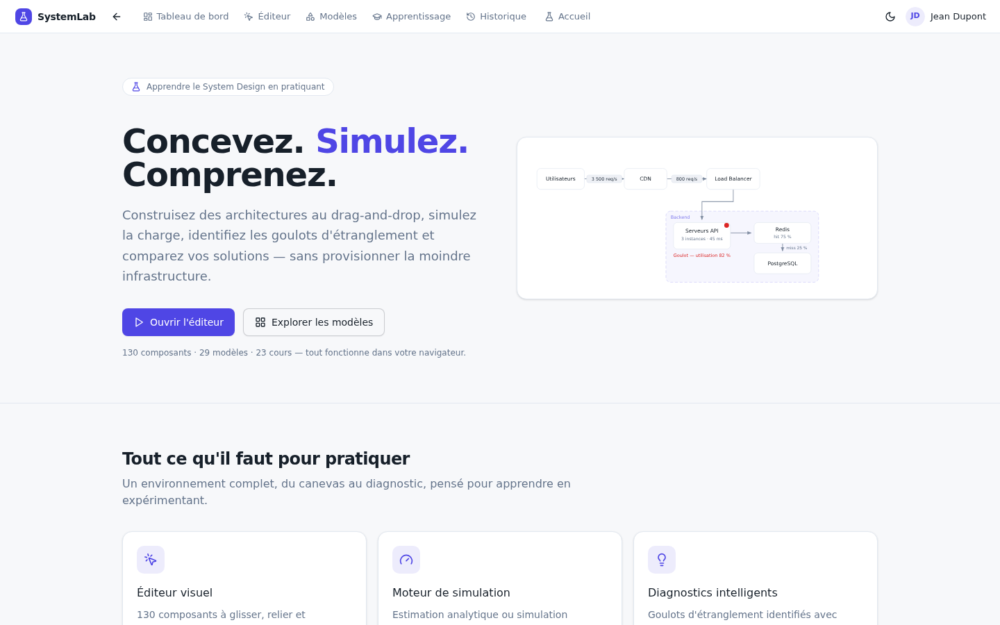</td>
    <td>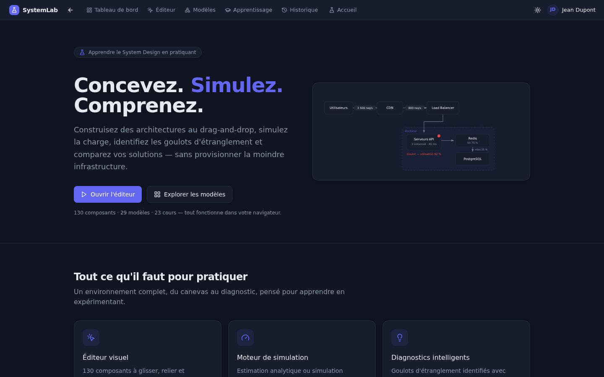</td>
  </tr>
  <tr>
    <td align="center"><sub>Thème clair</sub></td>
    <td align="center"><sub>Thème sombre</sub></td>
  </tr>
</table>

---

## Sommaire

1. [Présentation](#présentation)
2. [Fonctionnalités (avec captures)](#fonctionnalités)
3. [Démarrage rapide](#démarrage-rapide)
4. [Stack technique](#stack-technique)
5. [Architecture du code](#architecture-du-code)
6. [Documentation](#documentation)
7. [Limites connues](#limites-connues)
8. [Crédits](#crédits)

---

## Présentation

SystemLab est une application web mono-page (en français) qui réunit dans un seul outil
ce que l'on trouve d'habitude dispersé entre un tableur, un tableau blanc et des articles
de blog : **dessiner** une architecture réaliste, la **soumettre à une charge simulée**,
lire des **métriques honnêtes** (p95, débit servi, taux d'erreur, disponibilité, coût),
recevoir des **diagnostics argumentés**, **comparer** deux variantes A/B — le tout en
**apprenant** au fil de 23 cours progressifs avec exercices évalués sur vos propres
simulations.

Pensé pour : étudiants et développeurs qui préparent des entretiens de system design,
architectes qui veulent prototyper une idée avant de la défendre, curieux qui veulent
*comprendre* pourquoi une architecture tient — ou casse.

---

## Fonctionnalités

### 29 modèles d'architecture, dont 18 « géants de la tech »

Une galerie prête à l'emploi : YouTube, Facebook, WhatsApp, Netflix, Twitter/X, Uber,
Instagram, Google Search, Google Drive, Airbnb, Discord, Spotify, Zoom, Ticketmaster,
Stripe, Twitch, Reddit, Shopify… et 11 modèles classiques (API scalable, marketplace,
microservices, etc.). Chaque géant porte une **leçon de system design distincte**
(CDN pour Instagram, file d'attente virtuelle pour Ticketmaster, idempotence pour Stripe,
fan-out chat vidéo pour Twitch…), un **logo d'entreprise**, un fait marquant et une
miniature de son diagramme.

Recherche insensible aux accents (nom, description, tags, entreprise), fiches de détail
complètes et chargement en un clic dans l'éditeur.

<table>
  <tr>
    <td>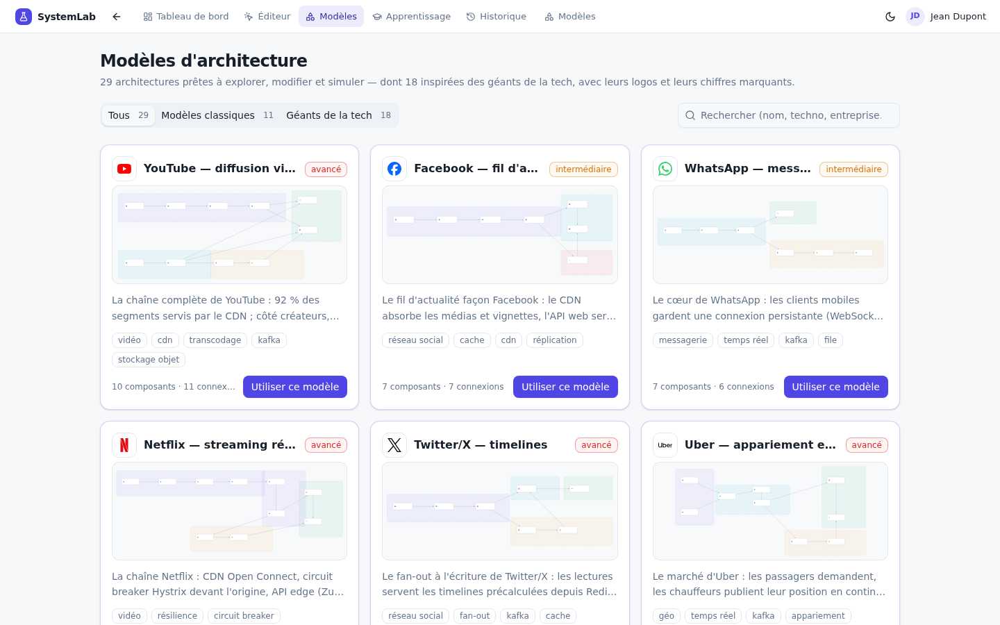</td>
    <td>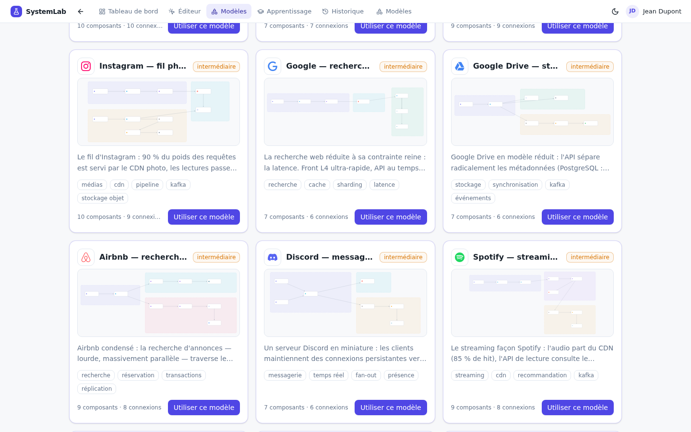</td>
  </tr>
  <tr>
    <td align="center"><sub>Galerie + recherche insensible aux accents</sub></td>
    <td align="center"><sub>Section « géants de la tech »</sub></td>
  </tr>
</table>

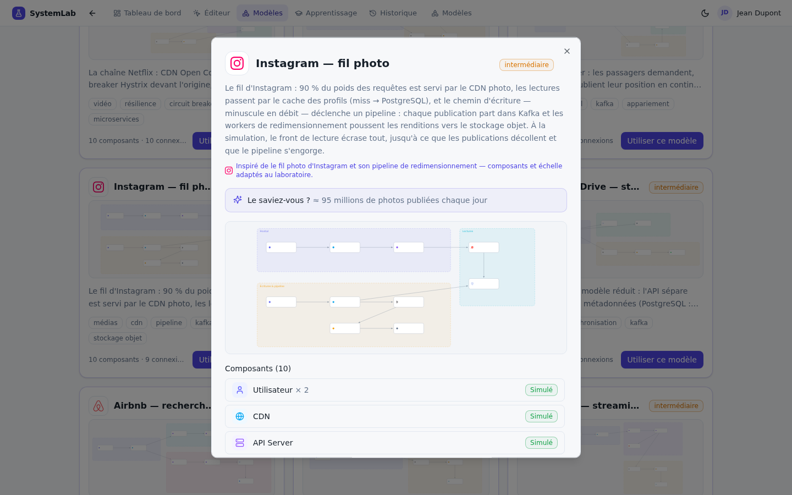

<sub>Fiche de détail d'un modèle : logo d'entreprise, miniature du diagramme, fait marquant, composants avec leurs logos de marques et cours lié.</sub>

### Éditeur visuel au glisser-déposer

**130 composants en 18 catégories** (clients, réseau, compute, SQL, NoSQL, cache,
messagerie, stockage, recherche, sécurité, résilience, observabilité, architecture
distribuée, traitements différés, IA, services métier, infrastructure, communication).
Glisser-déposer, connexion par poignées, regroupement par **zones**, configuration fine
de chaque composant (connexions, réplicas, workers, cache hit…), annuler/refaire,
Ctrl+S, sauvegarde automatique avec indicateur « modifications non enregistrées »,
brouillon de session en cas de fermeture accidentelle.

Les technologies qui ont un logo officiel (Redis, Docker, Kafka, PostgreSQL, MySQL,
MongoDB, Cassandra, RabbitMQ, Elasticsearch, Prometheus, Grafana, Kubernetes, NGINX,
GraphQL…) l'affichent **en version réelle** sur le canvas, dans la bibliothèque et les
panneaux — avec une stratégie de lisibilité dédiée au thème sombre.

<table>
  <tr>
    <td>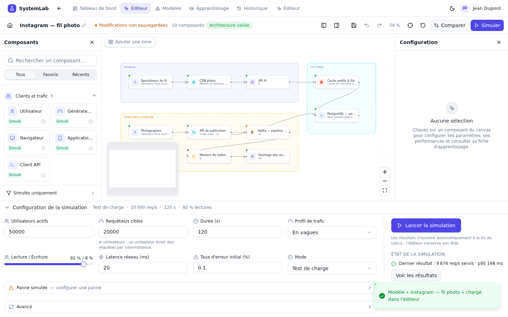</td>
    <td>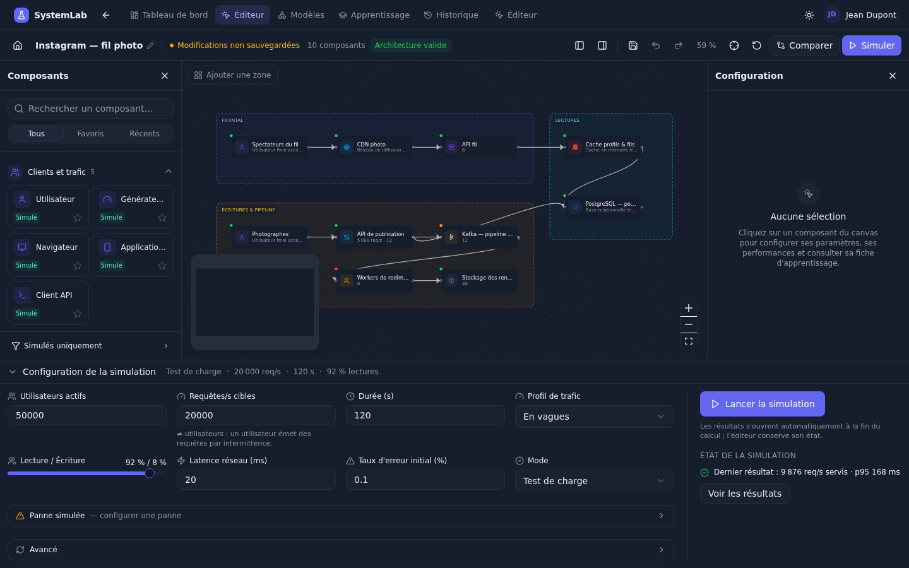</td>
  </tr>
  <tr>
    <td align="center"><sub>Éditeur — modèle Instagram (logos réels sur les nœuds)</sub></td>
    <td align="center"><sub>Même architecture en thème sombre</sub></td>
  </tr>
</table>

### Deux moteurs de simulation

- **Estimation analytique instantanée** (onglet Performance) : loi de Little,
  utilisation, temps de service, pour dimensionner en quelques secondes.
- **Simulation événementielle discrète** : arrivées poissonniennes, files FIFO,
  concurrence par slots, pool de connexions base, hit/miss de cache avec TTL et
  éviction, répartition L4/L7, token bucket, circuit breaker, **pannes injectées**,
  seed déterministe (rejouable à l'identique), échantillonnage au-delà de
  100 000 requêtes pour rester interactif.

Le moteur est **pur** (aucune dépendance à React), testable et documenté formule par
formule dans [`docs/engine.md`](docs/engine.md).

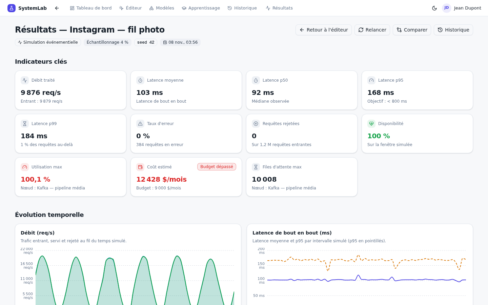

<sub>Chaque simulation produit ses indicateurs clés : débit traité, latence p50/p95/p99, taux d'erreur, disponibilité, coût mensuel estimé…</sub>

### Résultats, graphiques et diagnostics

11 indicateurs, 5 graphiques temporels (débit, latence, files, erreurs), une **carte de
charge** qui colore chaque nœud selon son utilisation (navigable au clavier), un tableau
de métriques par composant, et **plus de 13 règles de diagnostic** explicites — saturation,
files instables, SPOF, cache peu efficace, épuisement de connexions, cascades de timeouts,
lag de files… — chacune avec métriques justificatives, cause probable, explication
pédagogique et solutions argumentées (conditions + compromis). Le panneau « Hypothèses »
rappelle à chaque run ce que le modèle suppose.

<table>
  <tr>
    <td>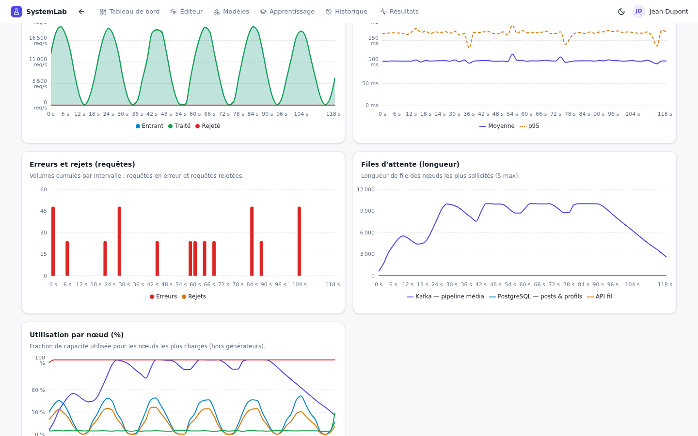</td>
    <td>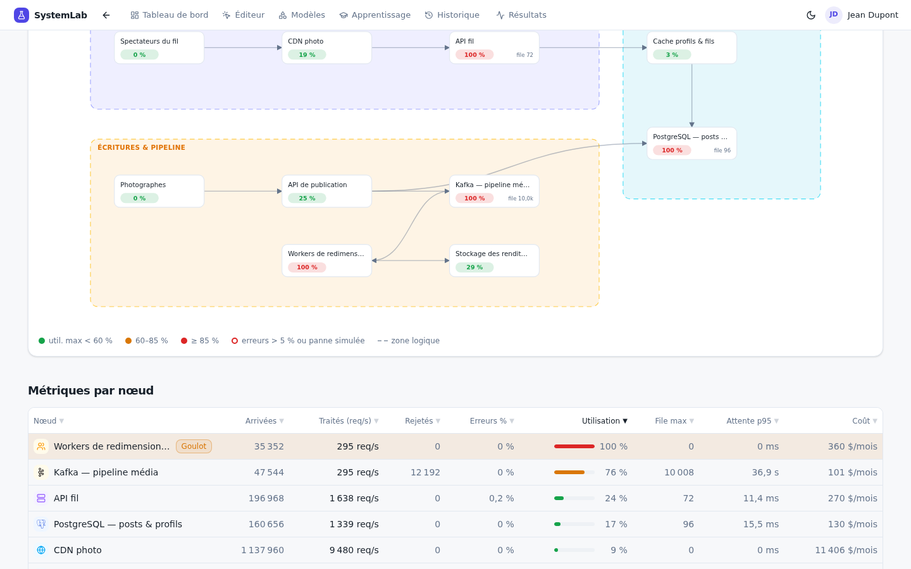</td>
  </tr>
  <tr>
    <td align="center"><sub>Séries temporelles (débit, latence…)</sub></td>
    <td align="center"><sub>Carte de charge + goulots détectés</sub></td>
  </tr>
</table>

### Comparaison A/B

Archivez chaque simulation dans l'historique (SQLite), cochez-en deux, comparez :
**11 métriques avec deltas orientés** (meilleur/pire), graphiques côte à côte et
résumé automatique des compromis (« +40 % de débit pour +12 % de coût »).

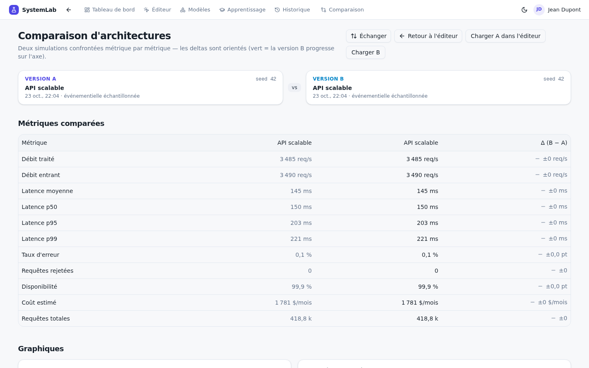

<sub>Comparaison de deux simulations : deltas orientés, graphiques et résumé des compromis.</sub>

### Apprentissage guidé, avec évaluation réelle

**23 cours progressifs** (débutant → avancé : client-serveur, HTTP, cache, load balancing,
sharding, files de messages, résilience, cohérence distribuée, consensus, CAP, CQRS,
event sourcing, sagas, multi-région, gestion des pannes…), chacun avec :

- un **sommaire actif** (section suivie pendant la lecture), une **barre de progression**
  et une navigation clavier entre cours ;
- une boîte **« À retenir »** (points densifiés pour les relectures) ;
- un **quiz corrigé** dont les réponses persistent dans le navigateur ;
- un **système d'XP et 5 niveaux** (Curieux → Architecte principal) pour suivre sa
  progression — locale, sans compte ;
- **15 exercices pratiques** avec objectif chiffré (ex. « p95 < 150 ms »), réalisés dans
  l'éditeur puis **évalués automatiquement sur vos métriques simulées** : la plateforme
  confronte chaque critère aux résultats réels du run et rend un verdict argumenté.

<table>
  <tr>
    <td>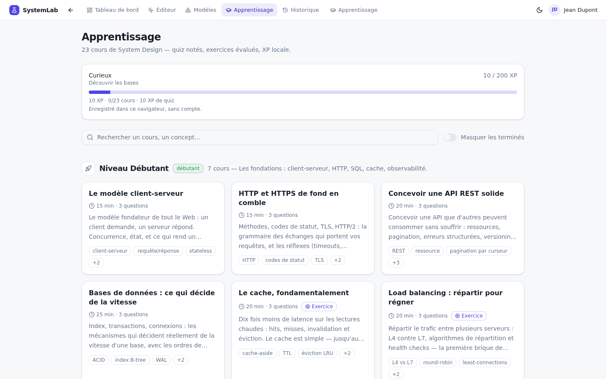</td>
    <td>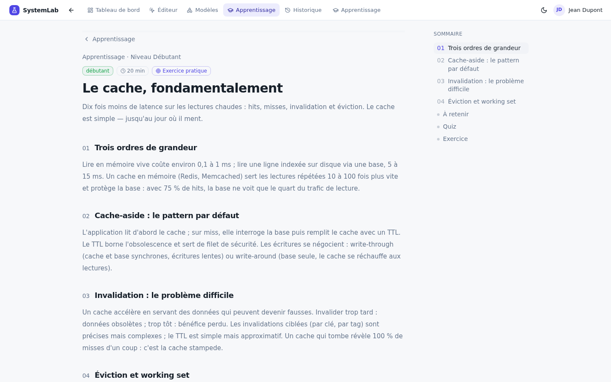</td>
  </tr>
  <tr>
    <td align="center"><sub>Liste des cours + carte XP / niveau</sub></td>
    <td align="center"><sub>Cours : sommaire actif, sections numérotées</sub></td>
  </tr>
</table>

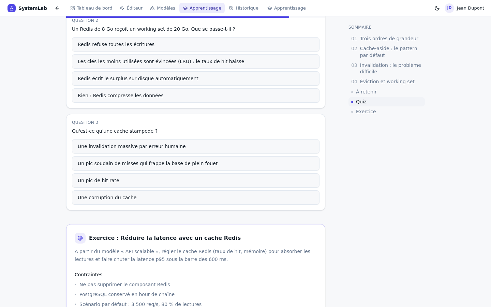

<sub>Quiz corrigé, réponses persistantes — la progression survit aux rechargements.</sub>

### Dark mode, mobile et accessibilité

Thème clair/sombre persistant (y compris sur le canvas et la mini-carte), interface
responsive jusqu'à 360 px (navigation en menu, tables défilantes, toolbar adaptée),
statut de simulation annoncé (`aria-live`), carte de charge et tableaux navigables au
clavier, graphiques décrits pour lecteurs d'écran.

<table>
  <tr>
    <td>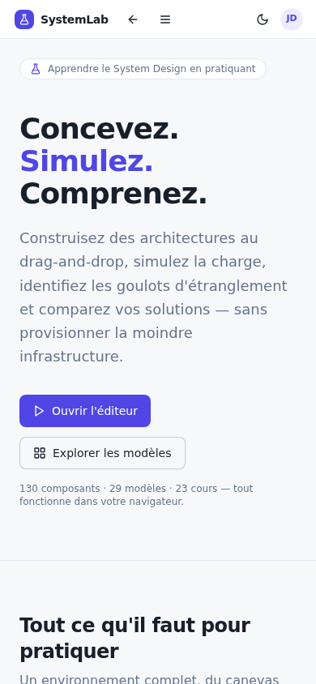</td>
    <td>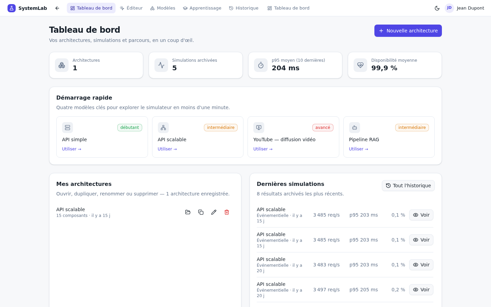</td>
  </tr>
  <tr>
    <td align="center"><sub>Mobile (390 px)</sub></td>
    <td align="center"><sub>Tableau de bord : architectures + simulations récentes</sub></td>
  </tr>
</table>

---

## Démarrage rapide

```bash
bun install          # dépendances
bun run db:push      # crée/synchronise la base SQLite (db/custom.db)
bun run dev          # serveur de développement → http://localhost:3000
bun run lint         # qualité de code (ESLint — 0 erreur, 0 warning)
```

> Aucune variable d'environnement n'est nécessaire au-delà de `DATABASE_URL`
> (déjà configurée pour SQLite). Tout fonctionne en local, sans service distant.

Le premier lancement démarre sur la page d'accueil ; tout le reste (éditeur, résultats,
comparaison, modèles, apprentissage, historique, paramètres) se fait dans la même page —
l'application est une **SPA mono-route** pilotée par Zustand.

## Stack technique

| Couche | Choix |
| --- | --- |
| Framework | Next.js 16 (App Router), React 19, TypeScript 5 strict |
| UI | Tailwind CSS 4, shadcn/ui (New York), Lucide, Framer Motion, next-themes |
| Canvas d'architecture | @xyflow/react 12 (React Flow) |
| Graphiques | Recharts |
| État client | Zustand (app, éditeur, simulation, bibliothèque) |
| Persistance | Prisma 6 + SQLite — architectures et simulations archivées |
| Validation | Zod 4 (partagé client/serveur) |
| Moteur de simulation | TypeScript pur, sans framework — [`src/engine/`](src/engine/) |

## Architecture du code

```
src/
  app/            page unique (SPA) + routes API (architectures, simulations, santé)
  components/     éditeur (canvas React Flow, panneaux, toolbar),
                  résultats, comparaison, historique, modèles, apprentissage,
                  dashboard, paramètres, landing
  engine/         moteur de simulation PUR (sans React) — voir docs/engine.md
  data/           catalogue (130 composants / 18 catégories),
                  29 modèles (dont 18 géants de la tech), 23 cours
  stores/         Zustand : app (navigation), éditeur, simulation, bibliothèque
  lib/            persistance (façade API), validation Zod, logos de marques,
                  seuils et libellés partagés, formatage, icônes
  types/          contrat de types partagé
prisma/           schéma : Architecture + SimulationRecord (SQLite)
docs/             documentation du moteur + captures d'écran
```

**Routes API** : `GET/POST /api/architectures`, `GET/PATCH/DELETE /api/architectures/[id]`,
`POST /api/architectures/[id]/duplicate`, `GET/POST /api/simulations`,
`GET/DELETE /api/simulations/[id]`, `GET /api/health`.

## Documentation

- [`docs/engine.md`](docs/engine.md) — le moteur de simulation : modèle, formules,
  hypothèses et limites documentées honnêtement.
- Le panneau « Hypothèses » affiché avec chaque résultat de simulation.
- [`worklog.md`](worklog.md) — journal de développement détaillé (tâches, décisions,
  vérifications E2E).

## Limites connues

L'honnêteté fait partie du projet :

- **Composants « visuels »** (observabilité, patterns distribués, protocoles…) :
  pass-through neutre — leur badge l'indique clairement, ils ne prétendent jamais
  être simulés.
- **Échantillonnage** : au-delà de 100 000 requêtes simulées, une fraction du trafic
  est réellement jouée ; les volumes sont remis à l'échelle (taux affiché dans les
  résultats).
- **Coûts** : ordres de grandeur (±30 %), à lire comme des comparatifs entre variantes,
  pas comme des devis.
- **Pas de code de test automatisé** dans cet environnement — vérification manuelle
  navigateur E2E réalisée à la place (parcours complet validé, desktop + mobile,
  clair + sombre).
- **Session locale unique** (pas d'authentification) — la progression d'apprentissage
  vit dans le navigateur, les architectures et simulations en SQLite local.

## Crédits

- **Logos de marques** (Redis, Docker, Kafka, PostgreSQL, NGINX, Kubernetes… et les
  entreprises des modèles) : SVG issus de [simple-icons](https://simpleicons.org/)
  (licence CC0), intégrés statiquement dans le projet — aucun appel réseau.
- **Icônes UI** : [Lucide](https://lucide.dev/).
- Les architectures « géants de la tech » sont des **reconstitutions pédagogiques**
  simplifiées, inspirées de la culture publique du system design — pas des
  descriptions internes exactes de ces entreprises.
